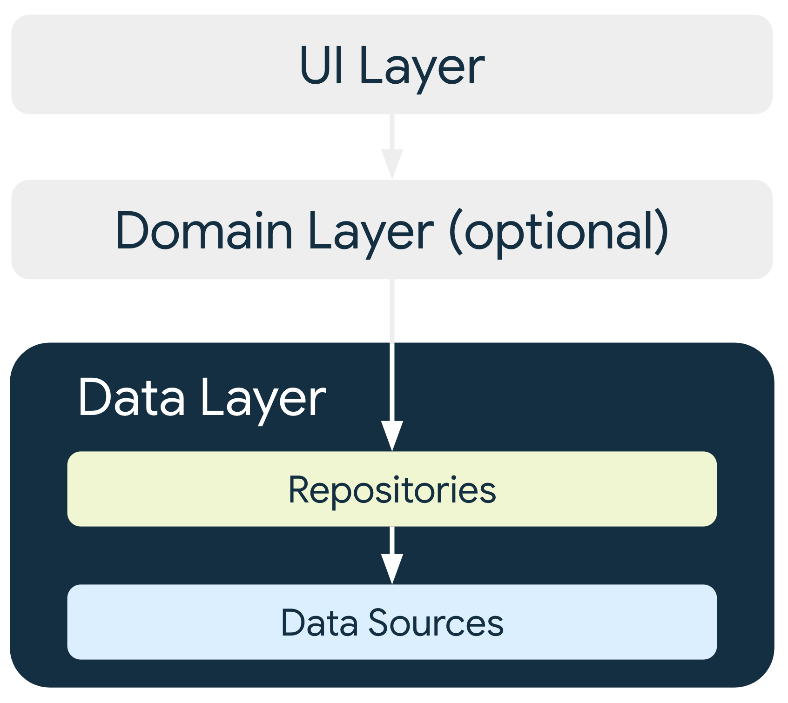

# Capa repositori i dades

Documents rellevants:

- https://developer.android.com/topic/architecture/data-layer
- https://developer.android.com/topic/architecture/domain-layer

## 1. Situació inicial

Partint del codi relatiu al RecyclerView, veurem que té algunes mancances o dificultats.
No respecta els principis de clean code, ni té cap arquitectura definida:

### Problemes d'arquitectura

**Absència de separació de capes:**
La Activity accedeix directament a les dades (directament a la llista en memòria o mitjançant una API). Això crea un acoblament fort i dificulta enormement el testing i el manteniment.

**DataSource com a singleton estàtic:**
Qualsevol canvi en com s'obtenen les dades (API, base de dades local, etc.) requerirà modificar directament la Activity, però també tots els llocs on s'utilitza.

**Lògica de negoci a la UI:** La Activity està fent massa coses: configura el RecyclerView, gestiona el clic, i decideix què mostrar (el Toast o l'error). No hi ha cap ViewModel ni cap capa intermèdia que gestioni l'estat o la lògica.

### Problemes que pot ocasionar

- Escalabilitat nul·la: Quan el projecte creixi i necessitis múltiples fonts de dades, càrrega asíncrona, memòria cau, o sincronització, aquest codi serà molt difícil de mantenir.
- Impossibilitat de testing automàtic: Aquest codi fa els tests pràcticament impossibles.
- Duplicació de codi futura: Sense una arquitectura clara, cada nova funcionalitat similar acabarà repetint patrons, copiant i enganxant codi.

## 2. Anàlisi del codi incorrecte (sense separació de capes)

Item: Classe que conté les dades que necessitem (pot ser recepta, pel·lícula, reserva, itemcompra, ticket, etc.)

```kotlin
// Fitxer: MyItem.kt
data class MyItem(
    val id: Int,
    val title: String,
    val subtitle: String
)
```

DataSource: Classe (objecte en aquest cas) que conté la llista d'items

```kotlin
// Fitxer: DataSource.kt

/**
 * Objecte singleton que proporciona dades en memòria
 * per ser utilitzades al RecyclerView.
 */
object DataSource {

    // Llista de dades en memòria (només de lectura)
    val items: List<MyItem> = listOf(
        MyItem(1, "Element 1", "Subtítol 1"),
        MyItem(2, "Element 2", "Subtítol 2"),
        MyItem(3, "Element 3", "Subtítol 3"),
        MyItem(4, "Element 4", "Subtítol 4")
    )
}
```

Des de **l'Activity**, es crea la llista d'items, la qual cosa és incorrecte doncs no és la tasca de l'Activity.

```kotlin
// A dins de l'Activity o Composable
val items = DataSource.items
```

### Objectiu: separar la UI de les dades

Hem de fer que les dades siguin independents de la UI, perquè la UI pugui cridar un mètode genèric sense saber d'on venen les dades ni com s'obtenen.

La classe que coordina l'accés a les dades s'anomena **Repository**, i pertany a la **capa de dades** (Data Layer).

## 3. Arquitectura en 2 capes (UI + Dades)

Seguint l'arquitectura oficial d'Android, separarem el codi en dues capes:

1. **UI Layer** (Activity, Fragment, ViewModel)
2. **Data Layer** (Repository + DataSources)

```
┌──────────────────────────────────────────────────────┐
│  UI LAYER                                            │
│  Activity/Fragment → ViewModel                       │
│                             │
└──────────────┬───────────────────────────────────────┘
               │ Depèn de
               ▼
┌──────────────────────────────────────────────────────┐
│  DATA LAYER                                          │
│                                                      │
│  ItemsRepository (classe concreta)                   │
│  └─→ ItemsDataSource (interface)                     │
│      ├─→ MockItemsDataSource                         │
│      ├─→ RetrofitItemsDataSource                     │
│      └─→ RoomItemsDataSource                         │
└──────────────────────────────────────────────────────┘
```

El **Repository** és una classe concreta que actua com a punt d'entrada a la capa de dades. El ViewModel el rep directament.

Els **DataSources** són classes que implementen una interface, la qual cosa permet intercanviar la font de dades (Mock, API, Room) sense modificar el Repository.

## 4. Implementació

La implementació dels Datasources, es fa a través d'una interface. Això possibilita que el repositori cridi a les funcions dels datasources, sense saber amb quin datasource concret està treballant. Típicament els datasources poden: llegirItems, afegirItem, esborarItem, etc. Totes aquestes funcions les defineix la interface, i les implementen els Datasources.

Per altra banda, la definició del repositori tindrà com a paràmetre el Datasource Genèric (Interface) i cridarà les seves funcions sense saber exactament amb quin dels datasources està treballant.

#### Interface del DataSource

Defineix el contracte que han de complir totes les fonts de dades:

```kotlin
interface ItemsDataSource {
   fun getItems(): List<MyItem>
   fun addItem(item: MyItem)
   fun updateItem(item: MyItem)
   fun deleteItem(item: MyItem)
}
```

#### DataSources concrets

Ara podem crear múltiples DataSources, amb implementacions diferents (Mock, API, base de dades):

!!! note "Què és Mock?"
    Mock es refereix a dades falses, i s'utilitza en programació per provar les classes abans no es tingui una base de dades, API, etc.
    En aquest cas, el MockItemsDataSource és una llista precodificada (com havíem fet abans en el nostre object DataSource).

```kotlin
class MockItemsDataSource : ItemsDataSource {
   private val items = mutableListOf(
       MyItem(1, "Títol 1", "Subtítol A"),
       MyItem(2, "Títol 2", "Subtítol B"),
       MyItem(3, "Títol 3", "Subtítol C")
   )
   override fun getItems(): List<MyItem> = items
   override fun addItem(item: MyItem) { items.add(item) }
   override fun updateItem(item: MyItem) { /* implementació */ }
   override fun deleteItem(item: MyItem) { /* implementació */ }
}


class RetrofitItemsDataSource : ItemsDataSource {
   override fun getItems(): List<MyItem> { /* crida a l'API */ }
   override fun addItem(item: MyItem) { /* crida a l'API */ }
   override fun updateItem(item: MyItem) { /* crida a l'API */ }
   override fun deleteItem(item: MyItem) {
       RetrofitClient.instance.deleteItem(item.id).execute()
   }
}
```

!!! warning "Les crides de xarxa han de ser asíncrones"
    Aquest exemple usa signatures **síncrones** (`getItems(): List<MyItem>`) per simplificar i centrar-se en l'arquitectura per capes. En un projecte real, una font de dades Retrofit **no pot** cridar l'API de manera bloquejant: `Call.execute()` bloqueja el fil i, si es crida des del fil principal, llança `NetworkOnMainThreadException`. La solució és fer les funcions `suspend` (de la font fins al ViewModel) i usar corrutines amb les funcions `suspend` de Retrofit. Vegeu [Retrofit](../Llibreries/retrofit.md) i [Corrutines i Dispatchers](../Kotlin/coroutines.md).

#### Repository

El Repository és una **classe concreta** (sense interface). Rep un DataSource i li delega l'accés a les dades. No sap (ni li importa) si el DataSource és Mock, Retrofit o Room:

```kotlin
class ItemsRepository(
    private val dataSource: ItemsDataSource
) {
    fun getItems(): List<MyItem> {
        return dataSource.getItems()
    }

    fun addItem(item: MyItem) {
        dataSource.addItem(item)
    }

    fun updateItem(item: MyItem) {
        dataSource.updateItem(item)
    }

    fun deleteItem(item: MyItem) {
        dataSource.deleteItem(item)
    }
}
```

Per què el Repository és útil, si ara mateix només delega al DataSource?
Perquè quan el projecte creixi, el Repository serà el lloc on afegir:

- Gestió de memòria cau
- Combinació de múltiples fonts de dades (local + remota)
- Decisió de quan usar dades locals vs remotes
- Transformació de dades entre capes
- Gestió d'errors i fallbacks

El DataSource, en canvi, s'encarrega NOMÉS d'obtenir/guardar dades d'una font específica.

### Capa UI (UI Layer)

El ViewModel rep el Repository  directament:

```kotlin
class ItemsViewModel(
    private val repository: ItemsRepository
) : ViewModel() {

    fun getItems(): List<MyItem> {
        return repository.getItems()
    }

    fun addItem(item: MyItem) {
        repository.addItem(item)
    }
}
```

### Com es connecta tot

Totes les classes anteriors reben les seves dependències pel constructor: el Repository rep el DataSource, i el ViewModel rep el Repository. Cap d'elles crea les seves pròpies dependències. Per tant, falta una peça que creï les instàncies en l'ordre correcte i que decideixi quin DataSource concret s'utilitza.

Aquesta peça **no ha de ser l'Activity**. Si l'Activity fes `ItemsRepository(RetrofitItemsDataSource())`, tornaria a saber d'on venen les dades i tornaríem a tenir l'acoblament de la secció 1. A més, l'Activity es destrueix i es recrea (per exemple, en girar la pantalla), i cada vegada crearia un Repository nou.

Hi ha dues maneres habituals de fer-ho: a la Factory del ViewModel, o en un contenidor a la classe `Application`.

#### Opció 1: a la Factory del ViewModel

Com que `ItemsViewModel` té un paràmetre al constructor, no es pot crear amb un simple `by viewModels()`: cal una Factory (vegeu [ViewModelProvider i Factories](./viewmodel.md#3-viewmodelprovider-i-factories)). La Factory és el lloc on es munta tota la cadena DataSource → Repository → ViewModel:

```kotlin
class ItemsViewModel(
    private val repository: ItemsRepository
) : ViewModel() {

    fun getItems(): List<MyItem> = repository.getItems()

    fun addItem(item: MyItem) = repository.addItem(item)

    companion object {
        val Factory: ViewModelProvider.Factory = viewModelFactory {
            initializer {
                // Aquí és on es tria el DataSource concret
                val dataSource: ItemsDataSource = MockItemsDataSource()
                val repository = ItemsRepository(dataSource)
                ItemsViewModel(repository)
            }
        }
    }
}
```

L'Activity només referencia la Factory. No sap res del Repository ni del DataSource:

```kotlin
class ItemsActivity : AppCompatActivity() {

    private val viewModel: ItemsViewModel by viewModels { ItemsViewModel.Factory }

    override fun onCreate(savedInstanceState: Bundle?) {
        super.onCreate(savedInstanceState)
        setContentView(R.layout.activity_items)

        val items = viewModel.getItems()
        // ... configurar el RecyclerView amb items
    }
}
```

Per passar de Mock a Retrofit només cal canviar una línia de la Factory: `val dataSource: ItemsDataSource = RetrofitItemsDataSource()`. El Repository, el ViewModel i l'Activity no canvien.

!!! warning "Limitació"
    Cada Factory crea el seu propi Repository. Si dos ViewModels diferents utilitzen `ItemsRepository`, cadascun tindrà una instància diferent. Amb el `MockItemsDataSource`, això vol dir dues llistes separades: un element afegit des d'una pantalla no apareixeria a l'altra. Quan el Repository s'ha de compartir, cal l'opció 2.

#### Opció 2: un contenidor a la classe Application

La documentació oficial proposa crear un **contenidor de dependències** (`AppContainer`) que es crea una sola vegada, a la classe `Application`, i que conté les instàncies compartides per tota l'app.

[Veure la documentació oficial d'injecció de dependències manual](https://developer.android.com/training/dependency-injection/manual)

```kotlin
// Fitxer: AppContainer.kt
class AppContainer {
    // Aquí és on es tria el DataSource concret
    private val dataSource: ItemsDataSource = MockItemsDataSource()

    // Una única instància del Repository per a tota l'app
    val itemsRepository = ItemsRepository(dataSource)
}
```

```kotlin
// Fitxer: MyApplication.kt
class MyApplication : Application() {
    val container = AppContainer()
}
```

Perquè Android utilitzi aquesta classe, cal indicar-ho al `AndroidManifest.xml`:

```xml
<application
    android:name=".MyApplication"
    ... >
```

La Factory del ViewModel ja no crea el Repository, sinó que l'obté del contenidor:

```kotlin
import androidx.lifecycle.ViewModelProvider.AndroidViewModelFactory.Companion.APPLICATION_KEY

class ItemsViewModel(
    private val repository: ItemsRepository
) : ViewModel() {

    // ...

    companion object {
        val Factory: ViewModelProvider.Factory = viewModelFactory {
            initializer {
                val app = this[APPLICATION_KEY] as MyApplication
                ItemsViewModel(app.container.itemsRepository)
            }
        }
    }
}
```

L'Activity és exactament igual que a l'opció 1 (`by viewModels { ItemsViewModel.Factory }`). Ara, tots els ViewModels que demanin `itemsRepository` reben la mateixa instància, i el DataSource es tria en un únic lloc de l'app.

#### I en els tests?

En un test unitari no es fa servir cap Factory ni cap `Application`: el mateix test crea els objectes amb el DataSource que necessita.

```kotlin
val viewModel = ItemsViewModel(ItemsRepository(MockItemsDataSource()))
```

Aquest és l'avantatge principal de rebre les dependències pel constructor: qui crea l'objecte decideix la implementació (vegeu també [Avantatge: testabilitat](./settingsviewmodel.md#6-avantatge-testabilitat)).

## 5. Capa de Domini (opcional)

Segons la documentació oficial d'Android, la capa de Domini és **opcional**. S'afegeix quan necessitem **Use Cases**: lògica de negoci reutilitzable entre diferents ViewModels.

[Veure la documentació oficial de Domain Layer](https://developer.android.com/topic/architecture/domain-layer)

En l'arquitectura Android, la direcció de les dependències és natural (cap avall):

```
┌───────────────────────────────┐
│  UI LAYER                     │
│  ViewModel                    │
└──────────────┬────────────────┘
               │ depèn de
               ▼
┌───────────────────────────────┐
│  DOMAIN LAYER (opcional)      │
│  Use Cases                    │
└──────────────┬────────────────┘
               │ depèn de
               ▼
┌───────────────────────────────┐
│  DATA LAYER                   │
│  Repository + DataSources     │
└───────────────────────────────┘
```

El Domain Layer depèn del Data Layer (utilitza el Repository). Simplement afegeix una capa d'intermediaris (Use Cases) entre la UI i les dades.

!!! info
    Veure apartat de Use Cases per a més detalls.

## 6. Principis aplicats

- **Single Responsibility**: Cada classe té una única responsabilitat.
- **Separation of Concerns**: La UI no sap d'on venen les dades, el Repository no sap com s'obtenen, el DataSource no sap qui el crida.

### Inversió de dependències (DIP) entre Repository i DataSource

Dins la capa de dades, s'aplica el principi d'inversió de dependències entre el Repository i els DataSources.

**Sense DIP**, el Repository dependria directament d'una implementació concreta:

```kotlin
// ❌ Sense DIP: el Repository depèn d'una classe concreta
class ItemsRepository() {
    private val dataSource = MockItemsDataSource()  // acoblament fort

    fun getItems(): List<MyItem> {
        return dataSource.getItems()
    }
}
```

Si volem canviar de `MockItemsDataSource` a `RetrofitItemsDataSource`, hem de modificar el Repository.

**Amb DIP**, el Repository depèn d'una abstracció (interface):

```kotlin
// ✅ Amb DIP: el Repository depèn de la interface
class ItemsRepository(
    private val dataSource: ItemsDataSource  // interface, no implementació
) {
    fun getItems(): List<MyItem> {
        return dataSource.getItems()
    }
}
```

Si dibuixem les dependències (la fletxa vol dir "coneix" o "depèn de"), es veu clarament què canvia.

**Sense DIP**, el Repository apunta directament a una classe concreta:

```
┌──────────────────────────┐
│ ItemsRepository          │  mòdul d'alt nivell
└────────────┬─────────────┘
             │ depèn de
             ▼
┌──────────────────────────┐
│ MockItemsDataSource      │  mòdul de baix nivell
└──────────────────────────┘
```

**Amb DIP**, entre els dos apareix la interface, i totes les fletxes hi apunten:

```
┌──────────────────────────┐
│ ItemsRepository          │  mòdul d'alt nivell
└────────────┬─────────────┘
             │ depèn de
             ▼
┌──────────────────────────┐
│ «interface»              │  abstracció
│ ItemsDataSource          │
└──────────────────────────┘
             ▲
             │ implementen
┌────────────┴─────────────┐
│ MockItemsDataSource      │  mòduls de baix nivell
│ RetrofitItemsDataSource  │
│ RoomItemsDataSource      │
└──────────────────────────┘
```

Fixa't en la fletxa de sota. Sense DIP, la fletxa anava **del Repository cap al DataSource concret**. Ara la fletxa surt **dels DataSources concrets cap a la interface**: la dependència s'ha invertit. D'aquí ve el nom del principi.

El Repository només coneix `ItemsDataSource`; no sap que existeixen `MockItemsDataSource`, `RetrofitItemsDataSource` ni `RoomItemsDataSource`. Els DataSources concrets, en canvi, sí que coneixen la interface, perquè l'han d'implementar.

Tant el mòdul d'alt nivell (Repository) com els de baix nivell (DataSources concrets) depenen de l'abstracció. Això és el principi DIP:

> *"Els mòduls d'alt nivell no han de dependre dels mòduls de baix nivell. Ambdós han de dependre d'abstraccions."*

D'aquesta manera, podem canviar la implementació del DataSource (de Mock a Retrofit, de Retrofit a Room) sense tocar ni una línia del Repository ni de la UI.

!!! note
    En l'arquitectura Android, la DIP s'aplica **a nivell de classe** (entre Repository i DataSource), no entre capes. Per veure la DIP aplicada entre capes, consulteu l'apartat de Clean Architecture (secció 7).



## 7. Diferències amb Clean Architecture

L'arquitectura oficial d'Android i Clean Architecture (Uncle Bob) comparteixen la idea de separar en capes, però tenen diferències importants:

| | Arquitectura Android | Clean Architecture |
|---|---|---|
| **Repository** | Classe concreta al Data Layer | Interface al Domain + Implementació al Data |
| **Domain Layer** | Opcional. Conté Use Cases | Obligatori. És el nucli de l'aplicació |
| **Domain depèn de...** | Data Layer (direcció natural) | Res. És completament independent |
| **Direcció dependències** | UI → Domain → Data (cap avall) | UI → Domain ← Data (inversió entre capes) |
| **DIP entre capes** | No. Només a nivell de classe (DataSource interface) | Sí. El Data Layer implementa interfaces definides al Domain |

### Diagrama comparatiu

```
ANDROID ARCHITECTURE:           CLEAN ARCHITECTURE:

UI ──────▶ Domain ──────▶ Data  UI ──────▶ Domain ◀────── Data
          (opcional)                     (obligatori)
     tot cap avall                  tot apunta al Domain
```

En Clean Architecture, el Domain defineix les interfaces (contractes): la UI en depèn (a través dels Use Cases) i el Data les implementa. El Domain no depèn de ningú, és el nucli estable de l'aplicació.

!!! warning "Nota important"
    La documentació oficial d'Android inclou aquesta nota: *"The term 'domain layer' is used in other software architectures, such as 'clean' architecture, and has a different meaning there. Don't confuse the definition of 'domain layer' defined in the Android official architecture guidance with other definitions you may have read elsewhere."*

!!! info
    Veure apartat d'inversió de dependències per aprofundir en Clean Architecture.
