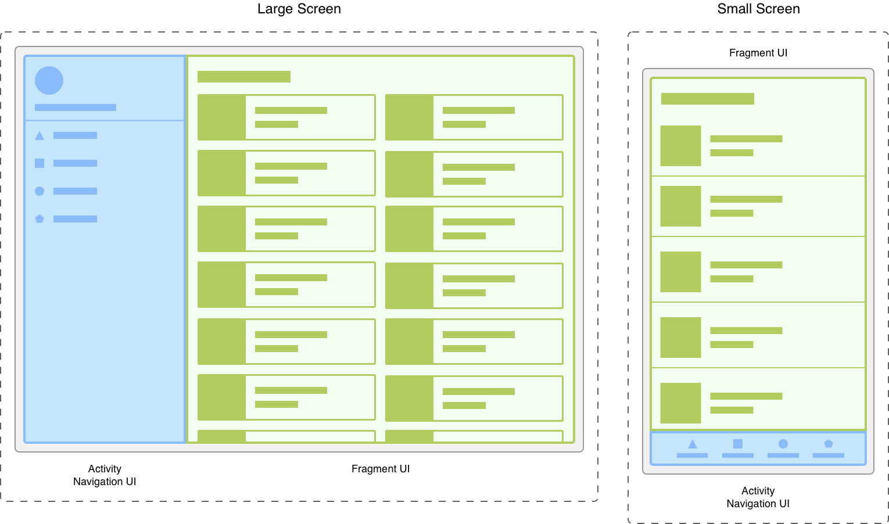
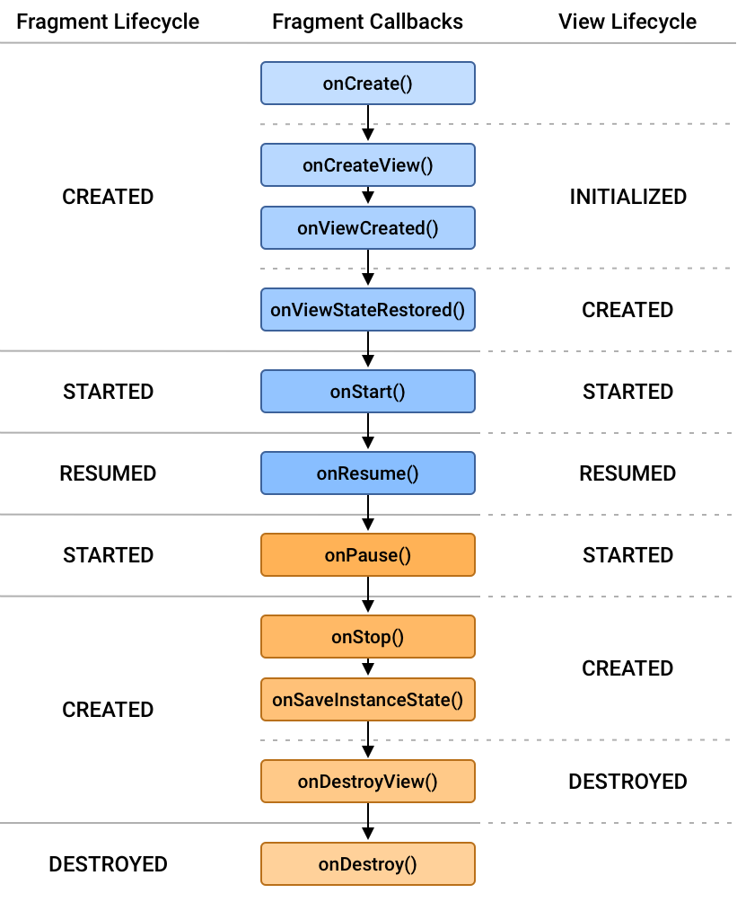
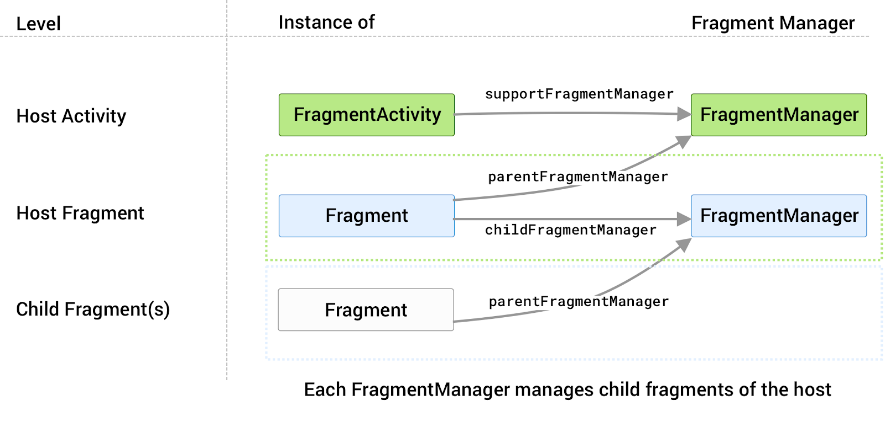
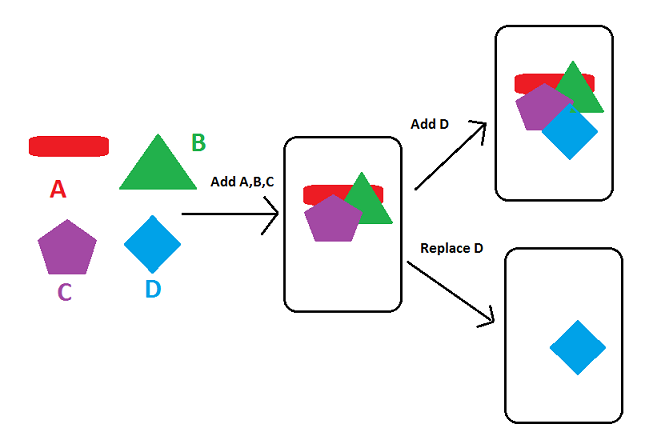

# Fragments
Documentació oficial

- https://developer.android.com/guide/fragments

Exemple pas a pas
- https://cursokotlin.com/capitulo-22-fragments-en-kotlin/


## 1. Introducció als Fragments: què són i per què utilitzar-los?

Definició: Components reutilitzables d'UI que representen una part d'una pantalla dins d'una Activity. Cada fragment té el seu cicle de vida. Han d'existir dins d'una activity o d'un altre fragment.

Avantatges:

- Reutilització: El mateix fragment pot usar-se en múltiples activities.

- Disseny adaptable: Diferents layouts per mòbils/tablets.

- Modularitat: Divideix la UI en components independents.

- Comparació: Els fragments són com "sub-activitats" amb cicle de vida propi.

Mostra visual d'una activity amb 2 fragments:


## 2. Anatomia d'un Fragment

### Estructura bàsica

Els fragments tenen layouts igual que les activities, en xml.

També tenen la seva classe Fragment() de la qual hereta i sobreescriu mètodes clau:
```kotlin
class NewFragment : Fragment() {

    override fun onCreate(savedInstanceState: Bundle?) {
        super.onCreate(savedInstanceState)
    }

    override fun onCreateView(
        inflater: LayoutInflater, container: ViewGroup?,
        savedInstanceState: Bundle?
    ): View? {
        // Inflate the layout for this fragment
        return inflater.inflate(R.layout.fragment_blank, container, false)
    }
    override fun onViewCreated(view: View, savedInstanceState: Bundle?) {
        val someInt = requireArguments().getInt("some_int")
        ...
    }
}
```

### Mètodes essencials:

- onCreateView(): Infla el layout i retorna la View.

- onViewCreated(): Configura les vistes un cop creades.


### Cicle de vida del Fragment



Punt important: onDestroyView() es crida abans que onDestroy(), alliberant la vista.

Referència: Cicle de vida dels Fragments: https://developer.android.com/guide/fragments/lifecycle

## 3. Implementació Bàsica
### Afegir fragments a una Activity

Mètode estàtic: Via XML amb etiqueta (per fragments fixos).
```xml
<androidx.fragment.app.FragmentContainerView
    xmlns:android="http://schemas.android.com/apk/res/android"
    android:id="@+id/fragmentContainerView"
    android:layout_width="match_parent"
    android:layout_height="match_parent" />
```
Mètode dinàmic: Via FragmentManager i FragmentTransaction (més flexible).

### FragmentManager i FragmentTransaction
 Referències: https://developer.android.com/guide/fragments/fragmentmanager

El fragmentmanager és la classe responsable d'afegir, eliminar i la resta d'accions sobre un fragment.
Al fragmentmanager hi accedim des de l'activity a través de la funció supportFragmentManager.

Des del fragment, podem accedir al fragmentmanager de la app, amb la funció getParentFragmentManager().



### Afegir fragment a un fragmentcontainer

Hi ha 2 maneres de carregar un fragment, afegint-lo a l'stack, o reemplaçant-lo.

- **BackStack:** Permet tornar enrere per tota la pila (stack) de fragments afegits.
- **Replace:** Substitueix la pila anterior per un altre. Només es pot tornar al fragment substituït.




```kotlin
    //Afegeix el fragment i l'afegeix a la pila (backstack)
    // de manera que tornar enrrere, tornara al fragment anterior.
    private fun addFragment(fragment: Fragment,args : Bundle?) {
        fragment.arguments = args
        val fragmentTransaction = supportFragmentManager.beginTransaction()
        fragmentTransaction.add(R.id.fragmentbottom, fragment)
        fragmentTransaction.addToBackStack(null)
        fragmentTransaction.commit()
    }
    //Intercanvia el fragment. Tornar enrrere no tornara al fragment anterior.
    private fun replaceFragment(fragment: Fragment,args : Bundle?){
        fragment.arguments = args
        val fragmentTransaction = supportFragmentManager.beginTransaction()
        fragmentTransaction.replace(R.id.fragmentbottom, fragment)
        fragmentTransaction.commit()
    }
```

La documentació d'Android recomana cridar també `setReorderingAllowed(true)`. A més, com que cada mètode de la transacció retorna la mateixa `FragmentTransaction`, les crides es poden encadenar sense guardar-la en una variable:

```kotlin
private fun addFragment(fragment: Fragment, args: Bundle?) {
    supportFragmentManager.beginTransaction()
        .setReorderingAllowed(true)
        .add(R.id.fragmentbottom, fragment::class.java, args)
        .addToBackStack(null)
        .commit()
}
```

Per exemple, des de l'activity:

```kotlin
addFragment(SegonFragment(), null)
```

## 4. Comunicació
### Accedir a l'Activity des del Fragment

De vegades necessitem accedir a l'activity, per exemple si necessitem modificar la appbar o toolbar.

```kotlin
// Forma segura - llança excepció si no hi ha activity
val activity = requireActivity()

// Forma nullable - retorna null si no hi ha activity  
val activity = activity

// Modificar Toolbar
(requireActivity() as AppCompatActivity).supportActionBar?.title = "Nou Títol"
```

### Amb shared Viewmodels

Vegeu documentació a [Shared Viewmodels](../Arquitectura/viewmodel.md)

## 5. Navegar d'un fragment a un altre

Un cas molt habitual és tenir una activity amb un sol `FragmentContainerView` on es van intercanviant fragments: en fer click a un botó del primer fragment, es carrega el segon fragment al mateix lloc, i en prémer el botó enrere es torna al primer.

Hi ha dues maneres de fer-ho, segons qui fa la transacció:

- **Opció 1:** el mateix fragment fa la transacció amb `parentFragmentManager`.
- **Opció 2:** el fragment avisa l'activity a través d'una interfície, i és l'activity qui fa la transacció.

En els dos casos, l'activity carrega el primer fragment de la mateixa manera:

```kotlin
// MainActivity.kt
class MainActivity : AppCompatActivity() {

    override fun onCreate(savedInstanceState: Bundle?) {
        super.onCreate(savedInstanceState)
        setContentView(R.layout.activity_main)

        // Fragment inicial (només la primera vegada, no en girar la pantalla)
        if (savedInstanceState == null) {
            supportFragmentManager.beginTransaction()
                .add(R.id.fragmentContainerView, PrimerFragment())
                .commit()
        }
    }
}
```

### Opció 1: Navegar amb parentFragmentManager

Des d'un fragment, `parentFragmentManager` retorna el `FragmentManager` que el gestiona. Si el fragment està dins d'una activity, és el mateix `supportFragmentManager` de l'activity (vegeu [FragmentManager i FragmentTransaction](#fragmentmanager-i-fragmenttransaction)). Per tant, el fragment pot substituir-se a si mateix pel següent fragment:

```kotlin
// PrimerFragment.kt
class PrimerFragment : Fragment(R.layout.fragment_primer) {

    override fun onViewCreated(view: View, savedInstanceState: Bundle?) {
        super.onViewCreated(view, savedInstanceState)

        view.findViewById<Button>(R.id.btnAcceptar).setOnClickListener {
            parentFragmentManager.beginTransaction()
                .setReorderingAllowed(true)
                .replace(R.id.fragmentContainerView, SegonFragment())
                .addToBackStack(null)
                .commit()
        }
    }
}
```

L'activity no ha de fer res més: només carrega el primer fragment, com hem vist abans.

Gràcies a `addToBackStack(null)`, en prémer el botó enrere es torna a `PrimerFragment`.

!!! warning "Inconvenients"
    Aquesta opció és la més senzilla, però el fragment queda lligat a l'activity on es fa servir:

    - Ha de conèixer l'id del contenidor (`R.id.fragmentContainerView`), que pertany al layout de l'activity.
    - Decideix ell mateix quin és el fragment següent (`SegonFragment`).

    Si volem reutilitzar `PrimerFragment` en una altra activity, amb un altre contenidor o que hagi d'anar a un altre fragment, caldrà modificar-lo.

### Opció 2: Navegar a través de l'activity amb una interfície

Per evitar els inconvenients anteriors, repartim les responsabilitats:

- El **fragment** només avisa que la seva tasca ha finalitzat. No sap quin fragment s'ha de carregar després.
- L'**activity** rep l'avís i decideix què fer: és l'única que fa transaccions sobre el contenidor.

L'avís es fa a través d'una interfície definida dins del mateix fragment, que l'activity implementa.

#### Fragment

El fragment defineix la interfície `Listener` i, quan ha acabat la seva tasca (en aquest cas, en prémer el botó), ho comunica a la seva activity:

```kotlin
// PrimerFragment.kt
class PrimerFragment : Fragment(R.layout.fragment_primer) {

    interface Listener {
        fun onFragmentFinalitzat()
    }

    override fun onViewCreated(view: View, savedInstanceState: Bundle?) {
        super.onViewCreated(view, savedInstanceState)

        view.findViewById<Button>(R.id.btnAcceptar).setOnClickListener {
            val activity = requireActivity()

            // Comprovem que l'activity implementa la interfície
            if (activity is Listener) {
                (activity as Listener).onFragmentFinalitzat()
            } else {
                throw IllegalStateException("${activity::class.simpleName} ha d'implementar PrimerFragment.Listener")
            }
        }
    }
}
```

!!! note "Typecast no necessari"
    Dins de l'`if (activity is Listener)`, Kotlin ja sap que `activity` és de tipus `Listener` (*smart cast*), així que el typecast `(activity as Listener)` no és necessari i Android Studio el marca amb l'avís "No cast needed". L'hem deixat per fer més explícit que estem cridant un mètode de la interfície, però també es pot escriure directament `activity.onFragmentFinalitzat()`.

    Més informació: [Type checks and casts](https://kotlinlang.org/docs/typecasts.html#smart-casts)

#### Activity

L'activity implementa `PrimerFragment.Listener`, carrega el primer fragment i, quan rep l'avís, el substitueix pel segon:

```kotlin
// MainActivity.kt
class MainActivity : AppCompatActivity(), PrimerFragment.Listener {

    override fun onCreate(savedInstanceState: Bundle?) {
        super.onCreate(savedInstanceState)
        setContentView(R.layout.activity_main)

        // Fragment inicial (només la primera vegada, no en girar la pantalla)
        if (savedInstanceState == null) {
            supportFragmentManager.beginTransaction()
                .add(R.id.fragmentContainerView, PrimerFragment())
                .commit()
        }
    }

    override fun onFragmentFinalitzat() {
        supportFragmentManager.beginTransaction()
            .setReorderingAllowed(true)
            .replace(R.id.fragmentContainerView, SegonFragment())
            .addToBackStack(null)
            .commit()
    }
}
```

Gràcies a `addToBackStack(null)`, en prémer el botó enrere es torna a `PrimerFragment`.

!!! info "Avantatge"
    El fragment no depèn de l'activity ni dels altres fragments: només comunica que ha finalitzat. Així el mateix `PrimerFragment` es pot reutilitzar en una altra activity que decideixi fer una cosa diferent quan acabi.

## 6. Animació de les transicions entre fragments

Podem definir les animacions a la carpeta res/anim (tipus anim)

Arxius:

fade_out.xml
```
<!-- res/anim/fade_out.xml -->
<?xml version="1.0" encoding="utf-8"?>
<alpha xmlns:android="http://schemas.android.com/apk/res/android"
    android:duration="@android:integer/config_shortAnimTime"
    android:interpolator="@android:anim/decelerate_interpolator"
    android:fromAlpha="1"
    android:toAlpha="0" />
```

fade_in.xml
```
<!-- res/anim/slide_in.xml -->
<?xml version="1.0" encoding="utf-8"?>
<translate xmlns:android="http://schemas.android.com/apk/res/android"
    android:duration="@android:integer/config_shortAnimTime"
    android:interpolator="@android:anim/decelerate_interpolator"
    android:fromXDelta="100%"
    android:toXDelta="0%" />
```
En la transacció que intercanvia els fragments

```kotlin
        fragmentTransaction.setCustomAnimations(
            R.anim.fade_out, // exit
            R.anim.fade_in, // popEnter
        )
```

### Definir l'animació en entrar o sortir en el onCreate

Es creen els arxius en la carpeta res/transition (type transition)

Arxiu fade.xml
```kotlin
<!-- res/transition/fade.xml -->
<fade xmlns:android="http://schemas.android.com/apk/res/android"
    android:duration="@android:integer/config_shortAnimTime"/>
```
Arxiu slide.xml
```kotlin
<slide xmlns:android="http://schemas.android.com/apk/res/android"
    android:duration="@android:integer/config_shortAnimTime"
    android:slideEdge="right" />
```

en els fragments:
```kotlin
class FragmentA : Fragment() {
    override fun onCreate(savedInstanceState: Bundle?) {
        super.onCreate(savedInstanceState)
        val inflater = TransitionInflater.from(requireContext())
        exitTransition = inflater.inflateTransition(R.transition.fade)
    }
}

class FragmentB : Fragment() {
    override fun onCreate(savedInstanceState: Bundle?) {
        super.onCreate(savedInstanceState)
        val inflater = TransitionInflater.from(requireContext())
        enterTransition = inflater.inflateTransition(R.transition.slide)
    }
}
```